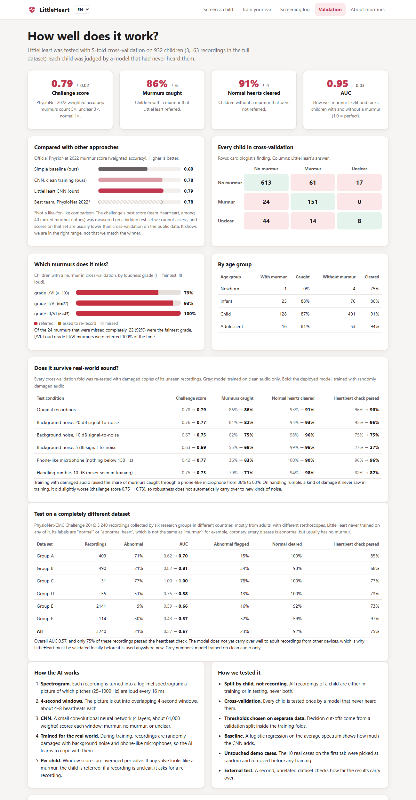

# LittleHeart

**AI heart murmur screening for children, running privately in the browser.**
Built for UnivaBio 2026: *Artificial Intelligence for Human Health*.

**Live app:** https://turan16-k.github.io/UnivaBio/

A community health worker records a child's heart at the four valve areas. LittleHeart tells them whether a murmur is likely: **refer for echocardiogram**, **no murmur detected**, or **recording unclear, record again**. It also shows *where* and *when* in the recording the murmur was heard.


## Why

About 1 in 100 babies is born with a heart defect, and rheumatic heart disease affects tens of millions of people, mostly young and in low- and middle-income countries. Both often show up first as a heart murmur. Hearing one reliably takes years of practice, and the echocardiograms that confirm it are scarce where they are needed most. LittleHeart gives every health worker with a stethoscope a consistent second opinion, so echocardiograms go to the children who need them.

## Features

- **Guided recording**: step-by-step through the four listening sites, with a live waveform, sound-level meter and heartbeat check, 15 seconds per site
- **Real cases**: 10 children from the dataset that the model never trained on, with the cardiologist's finding revealed after analysis
- **Upload** recordings (WAV/MP3; valve detected from file names like `child_MV.wav`)
- **Explainable results**: chest diagram per valve, spectrogram with playback cursor, murmur-likelihood timeline per 4-second window
- **Train your ear**: 18 real recordings to practise on; the AI's answers come from cross-validation models that never heard those children
- **Screening log** for school or village screening days, stored only on the device, with CSV export
- **Printable screening note** for the family or clinic
- **4 languages**: English, Turkish, Portuguese, Spanish (chosen from the browser language, switchable)
- **Works offline** after the first visit and installs like an app (service worker + web app manifest)
- **Private**: all processing in the browser with ONNX Runtime Web; audio never leaves the device
- **Validation tab**: cross-validated metrics, error analysis by murmur grade and age, robustness to damaged audio, an external dataset test and an honest status table

## Run it

The page loads its model with `fetch`, so serve it over HTTP:

```bash
python -m http.server 8000 -d web
# open http://localhost:8000      (or http://localhost:8000/?case=1 to open a demo case directly)
```

On GitHub, the included workflow (`.github/workflows/pages.yml`) publishes `web/` automatically: set **Settings → Pages → Source** to **GitHub Actions**.

## Reproduce everything

```bash
pip install numpy scipy scikit-learn torch onnx onnxruntime reportlab pytest
python ml/download_data.py                  # CirCor dataset (~550 MB)
python ml/download_data.py --external       # PhysioNet 2016 dataset for the external test (~200 MB)
python ml/heartbeat_check.py                # calibrate the heartbeat safety check
python ml/train.py --robust                 # deployed model: CV + analysis + final model (~3 h on a laptop CPU)
python ml/train.py --no-final --out data/eval_clean   # comparison: same CV, clean-only training
python ml/external_validation.py            # external test of the deployed model
python ml/compare_models.py data/eval_clean/model/metrics.json data/external_clean_model.json
python -m pytest                            # tests (Node.js needed for the JavaScript checks)
python docs/make_pdfs.py                    # submission PDFs
```

`data/external_clean_model.json` is the external test of the earlier clean-trained model (`python ml/external_validation.py <its model folder>`).

## How it works

1. **Spectrogram** (`ml/features.py`, `web/js/features.js`): the recording is normalised to unit loudness and turned into a 32-band log-mel spectrogram (25–1000 Hz, 64 ms frames every 16 ms).
2. **Windows**: the spectrogram is cut into 4-second windows every 2 seconds.
3. **CNN** (`ml/train.py`): four convolution blocks (16-32-64-64 channels), global average pooling, 3 outputs: no murmur / murmur / unclear. About 61,000 weights, trained with AdamW and class-weighted cross-entropy.
4. **Trained for the real world** (`ml/evaluation.py`): 60% of training windows are damaged at random, with a missing low end (high-pass at 60–250 Hz, like a phone microphone) and/or background noise (3–30 dB signal-to-noise).
5. **Heartbeat safety check** (`ml/heartbeat_check.py`): before the CNN is trusted, the low-frequency loudness must rise and fall deeply and regularly at 40–220 beats per minute. The limits are calibrated so 96% of real recordings pass. In 10 synthetic trials each, white noise, pink noise, a steady tone, mains hum and silence were rejected 10/10, and speech-like babble 8/10. Rhythmic non-heart sounds such as a metronome can still pass. Failed recordings are reported as "no heartbeat found, record again".
6. **Per child**: window probabilities are averaged per valve. The result is *murmur* if any valve passes the murmur threshold, otherwise *unclear* if any recording passes the unclear threshold, otherwise *no murmur*. This is the same order as the PhysioNet challenge. Thresholds are tuned on a validation split, never on test children.

## Validation

Everything below comes from 5-fold cross-validation on the 932 non-demo children of the CirCor DigiScope dataset (3,163 recordings in total). The split is **by child**, so no child appears in both training and testing. Decision thresholds are tuned on a separate validation split inside each training fold. The 10 demo children were removed before any training.

### Main results

| | LittleHeart (deployed, robust training) | Same CNN, clean-only training | Baseline (logistic regression) |
|---|---|---|---|
| PhysioNet 2022 weighted accuracy | **0.789 ± 0.025** | 0.781 ± 0.035 | 0.596 |
| Children with a murmur referred (sensitivity) | **86%** | 86% | 57% |
| Children without a murmur not referred (specificity) | **91%** | 93% | 84% |
| AUC (murmur vs no murmur) | **0.95** | 0.94 | 0.73 |

For context only: the best team in the PhysioNet 2022 challenge scored 0.78 on the challenge's hidden test set. That set is harder and we cannot access it, so this is not a like-for-like comparison.

On the 10 untouched demo children, LittleHeart agrees with the cardiologist on 8. It misses none of the 4 murmurs. It asks for a re-recording of one child without a murmur, and calls one recording "no murmur" where the expert could not decide.

### Which murmurs does it miss?

| Murmur grade | Children | Referred | Missed |
|---|---|---|---|
| I/VI (faintest) | 103 | 81 (79%) | 22 |
| II/VI | 27 | 25 (93%) | 2 |
| III/VI (loud) | 45 | 45 (100%) | 0 |

22 of the 24 missed murmurs are the faintest grade. No loud murmur was missed.

### Robustness to real-world sound

Every fold was re-tested with damaged copies of its unseen recordings. The deployed model was trained with random noise and phone-like filtering; the comparison model was trained on clean audio only.

| Test condition | Clean-only training: score / murmurs caught | Robust training: score / murmurs caught |
|---|---|---|
| Original recordings | 0.78 / 86% | **0.79 / 86%** |
| Background noise, 20 dB SNR | 0.76 / 81% | **0.77 / 82%** |
| Background noise, 10 dB SNR | 0.67 / 62% | **0.75 / 75%** |
| Background noise, 5 dB SNR | 0.63 / 55% | **0.69 / 68%** |
| Phone-like microphone (nothing below 150 Hz) | 0.42 / 36% | **0.77 / 83%** |
| Handling rumble, 10 dB (never seen in training) | **0.75 / 79%** | 0.73 / 71% |

Robust training fixes the collapse with phone-like microphones. On rumble, a kind of damage it never saw, it did slightly worse, so robustness does not automatically carry over to new kinds of noise.

### External test on a different dataset

The deployed model was also run, unchanged, on the PhysioNet/CinC Challenge 2016 database: 3,240 recordings from six research groups, mostly adults and recorded on other devices, none used in training. Its labels are "normal" or "abnormal heart", not "murmur". For example, coronary artery disease is abnormal but usually has no murmur.

The murmur score separated abnormal from normal hearts with **AUC 0.57 overall**, ranging from 0.57 to 1.00 across the six groups. Only 75% of the recordings passed the heartbeat check. The model does not yet carry over to adult recordings from other devices, so it must be validated locally before use anywhere new.

Full numbers are in `web/model/metrics.json` and `web/model/external.json`. The training logs are in `docs/training_log.txt` (deployed model) and `docs/training_log_clean_model.txt`. The deployed model's log contains a long gap where the laptop was asleep.



## Limitations

- Research prototype; **not a medical device or a diagnosis**
- Trained on one population (north-east Brazil, mostly children) and one digital stethoscope; robustness to phones is tested on simulated damage, not on real phone adapters
- Generalises poorly to adult recordings from other devices (external test above); local validation is needed before use anywhere new
- Cannot yet distinguish innocent from pathological murmurs
- Cross-validation on the public data is not the challenge's hidden test set, so the leaderboard comparison is indicative only

## Project structure

```text
ml/download_data.py        dataset downloads (CirCor, PhysioNet 2016)
ml/features.py             spectrogram (Python)
ml/train.py                training, cross-validation, analysis, export
ml/evaluation.py           damaged-audio tests, augmentation, error analysis, quiz selection
ml/heartbeat_check.py      heartbeat safety check calibration
ml/external_validation.py  test on PhysioNet 2016
ml/compare_models.py       clean vs robust comparison
web/index.html             app
web/js/                    i18n, features, model, draw, app, guided, quiz, log, validation, main
web/sw.js                  offline support
web/model/                 exported ONNX model, config, metrics, external test
web/samples/, web/quiz/    recordings from the CirCor dataset (CC BY 4.0)
web/vendor/ort/            ONNX Runtime Web 1.20.1 (MIT)
tests/                     pytest suite incl. JS/Python parity and translation checks
docs/                      PDFs, screenshot, guides, training logs
```

## Data and credits

- Oliveira, J. et al. *The CirCor DigiScope Dataset: From Murmur Detection to Murmur Classification.* IEEE Journal of Biomedical and Health Informatics 26(6), 2524–2535 (2022). CC BY 4.0.
- Reyna, M. A. et al. *Heart murmur detection from phonocardiogram recordings: The George B. Moody PhysioNet Challenge 2022.*
- Liu, C. et al. *An open access database for the evaluation of heart sound algorithms.* Physiological Measurement 37(12), 2181–2213 (2016). PhysioNet/CinC Challenge 2016.
- ONNX Runtime Web, Microsoft, MIT licence.
