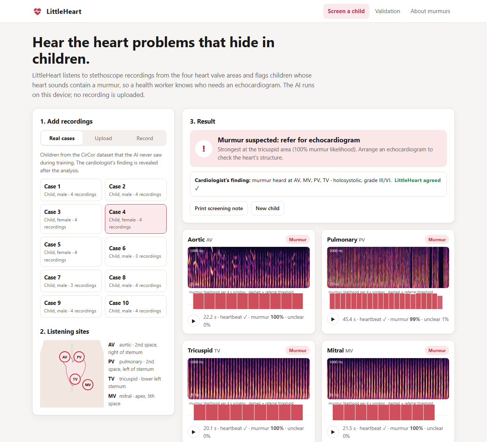

# LittleHeart

**AI heart murmur screening for children, running privately in the browser.**
Built for UnivaBio 2026: *Artificial Intelligence for Human Health*.

A community health worker records a child's heart at the four valve areas. LittleHeart tells them whether a murmur is likely: **refer for echocardiogram**, **no murmur detected**, or **recording unclear, record again**. It also shows *where* and *when* in the recording the murmur was heard.



## Why

About 1 in 100 babies is born with a heart defect, and rheumatic heart disease affects tens of millions of people, mostly young and in low- and middle-income countries. Both often show up first as a heart murmur. Hearing one reliably takes years of practice, and the echocardiograms that confirm it are scarce where they are needed most. LittleHeart gives every health worker with a stethoscope a consistent second opinion, so echocardiograms go to the children who need them.

## Features

- **Real cases**: 10 children from the dataset that the model never trained on, with the cardiologist's finding revealed after analysis
- **Upload** recordings (WAV/MP3; valve detected from file names like `child_MV.wav`) or **record** with a microphone or stethoscope adapter
- **Chest diagram** showing the result at each valve area
- **Explainable output**: spectrogram per recording with playback cursor and a murmur-likelihood timeline per 4-second window
- **Validation tab**: cross-validated metrics, comparison with a baseline and with the PhysioNet 2022 challenge, confusion matrix, honest status table
- **Private**: all processing in the browser with ONNX Runtime Web; audio never leaves the device

## Run it

The page loads its model with `fetch`, so serve it over HTTP:

```bash
python -m http.server 8000 -d web
# open http://localhost:8000      (or http://localhost:8000/?case=1 to open a demo case directly)
```

On GitHub, the included workflow (`.github/workflows/pages.yml`) publishes `web/` automatically: set **Settings → Pages → Source** to **GitHub Actions**.

## Reproduce the model

```bash
pip install numpy scipy scikit-learn torch onnx reportlab pytest onnxruntime
python ml/download_data.py     # ~550 MB from PhysioNet's open-data mirror
python ml/train.py             # cross-validation + final model + export (~1 h on a laptop CPU)
python ml/heartbeat_check.py   # calibrate the heartbeat safety check
python -m pytest               # tests, including Python/JavaScript parity (needs Node.js)
python docs/make_pdfs.py       # submission PDFs
```

## How it works

1. **Spectrogram** (`ml/features.py`, `web/js/features.js`): the recording is normalised to unit loudness and turned into a 32-band log-mel spectrogram (25–1000 Hz, 64 ms frames every 16 ms).
2. **Windows**: the spectrogram is cut into 4-second windows every 2 seconds.
3. **CNN** (`ml/train.py`): four convolution blocks (16-32-64-64 channels), global average pooling, 3 outputs: no murmur / murmur / unclear. About 61,000 weights, trained with AdamW, class-weighted cross-entropy and random-crop augmentation.
4. **Per valve**: window probabilities are averaged.
5. **Heartbeat safety check** (`ml/heartbeat_check.py`): before the CNN is trusted, the low-frequency loudness must rise and fall deeply and regularly at 40–220 beats per minute. Limits are calibrated so 96% of real recordings pass. In 10 synthetic trials each, white noise, pink noise, a steady tone, mains hum and silence were rejected 10/10 and speech-like babble 8/10. Rhythmic non-heart sounds such as a metronome can still pass. Failed recordings are reported as "no heartbeat found, record again".
6. **Per child**: *murmur* if any valve passes the murmur threshold, otherwise *unclear* if any recording passes the unclear threshold, otherwise *no murmur*. This is the same order as the PhysioNet challenge. Thresholds are tuned on a validation split, never on test children.

## Validation

- Dataset: CirCor DigiScope (PhysioNet), 942 children and 3,163 recordings, labelled by cardiologists
- Stratified K-fold cross-validation **split by child**, so no child is in both training and testing
- Metric: official PhysioNet 2022 murmur **weighted accuracy** (murmur ×5, unclear ×3, absent ×1), plus sensitivity, specificity and AUC
- Baseline: logistic regression on average spectrum statistics
- 10 demo children are removed before any training or cross-validation

The current numbers are in the app's Validation tab and in `web/model/metrics.json`. The full training log is in `docs/training_log.txt`.

## Limitations

- Research prototype; **not a medical device or a diagnosis**
- Trained on one population (north-east Brazil) and one digital stethoscope; untested with phone microphones or other devices
- Cannot yet distinguish innocent from pathological murmurs
- Cross-validation on the public data is not the challenge's hidden test set, so the leaderboard comparison is indicative only

## Project structure

```
ml/download_data.py   dataset download
ml/features.py        spectrogram (Python)
ml/train.py           training, cross-validation, export
ml/heartbeat_check.py heartbeat safety check calibration
web/index.html        app
web/js/features.js    spectrogram (JavaScript port)
web/js/model.js       in-browser inference and decision rule
web/js/app.js         user interface
web/css/style.css     styles
web/model/            exported ONNX model, config, metrics
web/samples/          demo recordings (CC BY 4.0)
tests/                pytest suite incl. JS/Python parity
docs/                 PDFs, screenshot, guides
```

## Data and credits

Oliveira, J. et al. *The CirCor DigiScope Dataset: From Murmur Detection to Murmur Classification.* IEEE Journal of Biomedical and Health Informatics, 26(6), 2524–2535 (2022). Reyna, M. A. et al. *Heart murmur detection from phonocardiogram recordings: The George B. Moody PhysioNet Challenge 2022.* Data via PhysioNet under CC BY 4.0.
